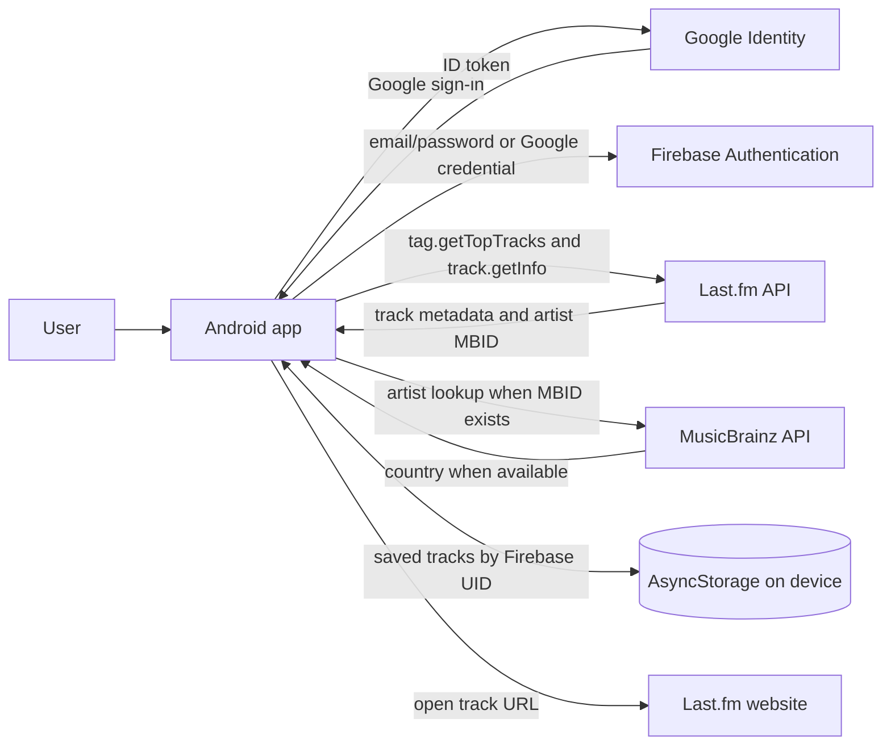

# Lost.fm

An Android music-discovery app built for the 2026/2 Mobile Development course project. It combines Firebase Authentication with the Last.fm API to explore tracks across regional music scenes.

The interface is intentionally small: sign in, tap the central mark, and explore a track. Lost.fm is an independent academic project and is not affiliated with Last.fm.

> [!NOTE]
> Last.fm supplies music metadata and links, not a playable audio file for this app. The headphones button opens the track on Last.fm.

## Features

- Email/password and Google sign-in with Firebase Authentication;
- Discovery across music scenes from different regions, with selection beyond the first page of Last.fm tag results;
- Title, artist, and a Last.fm tag on every discovery; cover art, duration, and verified artist country when available;
- A three-control result view: save, discover another track, or open Last.fm;
- Saved tracks stored locally on the device and separated by Firebase user;
- Sign-out and account deletion in the account menu.

The selection favors tracks with at most 350,000 listeners when Last.fm provides audience data. It does not guarantee that every suggestion is obscure. A country is shown only when MusicBrainz can confirm it; redundant geographic tags are hidden when other tags are available.

## System topology



There is no custom backend. Authentication is handled by Firebase; the app calls the music APIs directly. Google sign-in first obtains an ID token, which Firebase then uses to establish the app session. The Last.fm page opens outside the app when the listener taps the headphones button.

For each discovery, the app picks a regional scene, requests 50 tracks from a later chart page (pages 2–5), and inspects up to four random candidates. It prefers a candidate below the listener threshold; otherwise it keeps the least popular candidate it could inspect. `track.getInfo` may add cover art, duration, tags, audience size, and a MusicBrainz artist ID. The result always presents three Last.fm response values: track title, artist name, and a tag (track tag when available, otherwise the chart's scene tag). Missing optional metadata does not prevent a result from being shown.

## Architecture

| Part | Responsibility |
| :-- | :-- |
| `src/app/` | Expo Router entry and authenticated home route. |
| `src/screens/` | Sign-in and discovery interfaces. |
| `src/auth/` | Firebase session state. |
| `src/services/lastfm.ts` | Track selection, Last.fm requests, tag fallback, and MusicBrainz country lookup. |
| `src/components/` | Shared brand and loading components. |
| `assets/` | App identity and fallback artwork. |

Firebase authenticates users. Last.fm provides track candidates and details. MusicBrainz is consulted only when an artist identifier is available. AsyncStorage keeps saved tracks on the current device; it does not synchronize them between devices.

## Requirements

- Node.js and npm;
- A Firebase project with an Android app registered as `enzo.basaldella.lostfm`;
- Email/password and Google enabled in Firebase Authentication;
- A Last.fm API key;
- An Android device or emulator for the native app.

The project uses Expo SDK 58 and React Native Firebase. Expo Go cannot run these native modules; use a development build or an EAS-built APK.

## Local setup

Run commands from the repository root.

1. Install dependencies:

   ```bash
   npm ci
   ```

2. Copy `.env.example` to `.env` and set `EXPO_PUBLIC_LASTFM_API_KEY` and `EXPO_PUBLIC_GOOGLE_WEB_CLIENT_ID`. The latter is the OAuth **Web client ID** from the Firebase/Google configuration.
3. Download the Android `google-services.json` from Firebase and place it at the repository root. The package name in that file must match `enzo.basaldella.lostfm`.
4. Register the signing certificate SHA-1 and SHA-256 fingerprints in Firebase for each Android build you use. Google sign-in will not work if the fingerprint is missing.
5. With an Android SDK and a connected device or emulator, build and launch:

   ```bash
   npx expo run:android
   ```

After installing a native development build, start Metro with `npx expo start --dev-client`. Changes to native dependencies or Firebase configuration require a new native build.

> [!IMPORTANT]
> `.env` and `google-services.json` are intentionally ignored by Git. `EXPO_PUBLIC_` values are embedded in the application bundle and must not be treated as secrets. Never put the Last.fm shared secret or a Firebase service-account key in the app.

## Build an installable APK

Sign in to Expo with `npx eas-cli@latest login`, link your Expo project if necessary, and configure the **preview** environment in EAS:

| Variable | Type | Value |
| :-- | :-- | :-- |
| `GOOGLE_SERVICES_JSON` | File | The Firebase Android configuration file. |
| `EXPO_PUBLIC_LASTFM_API_KEY` | Text | Last.fm API key. |
| `EXPO_PUBLIC_GOOGLE_WEB_CLIENT_ID` | Text | Google OAuth Web client ID. |

Then run:

```bash
npx eas-cli@latest build --platform android --profile preview
```

The `preview` profile in `eas.json` creates an APK. Register the EAS signing certificate fingerprints in Firebase, update `GOOGLE_SERVICES_JSON` in EAS after downloading a fresh Firebase configuration, and rebuild if Google sign-in does not recognize the certificate.

## Validation

```bash
npm run lint
npm run typecheck
npx expo-doctor
```

On a device, verify both sign-in methods, discovery, reroll, save/remove, the saved-track panel, account deletion, sign-out, and the Last.fm link. If track metadata is incomplete, the app uses the chart tag, a fallback cover, or an unknown duration rather than inventing track details.

## Project structure

```text
.
├── .github/workflows/   lint and typecheck on push and pull request
├── assets/             brand images and fallback artwork
├── scripts/            transparent-mark generation
├── src/
│   ├── app/             routes
│   ├── auth/            Firebase session
│   ├── components/      shared UI
│   ├── screens/         sign-in and discovery
│   └── services/        music data
├── app.config.ts        native app configuration
├── eas.json             Android APK build profile
└── package.json         dependencies and local commands
```

## External services and limitations

- [Last.fm API](https://www.last.fm/api): `tag.getTopTracks` and `track.getInfo` provide discovery candidates and metadata.
- [MusicBrainz API](https://musicbrainz.org/doc/MusicBrainz_API): artist-country lookup when a MusicBrainz artist ID is available. Requests are cached and paced to respect its [one-request-per-second policy](https://musicbrainz.org/doc/MusicBrainz_API/Rate_Limiting).
- [Firebase Authentication](https://firebase.google.com/docs/auth): account registration and sign-in.

Music availability and metadata depend on external services. Saved tracks are local to one device, and listening happens outside the app on Last.fm. This repository contains source code, not Firebase credentials, an APK, or assignment/presentation files.
